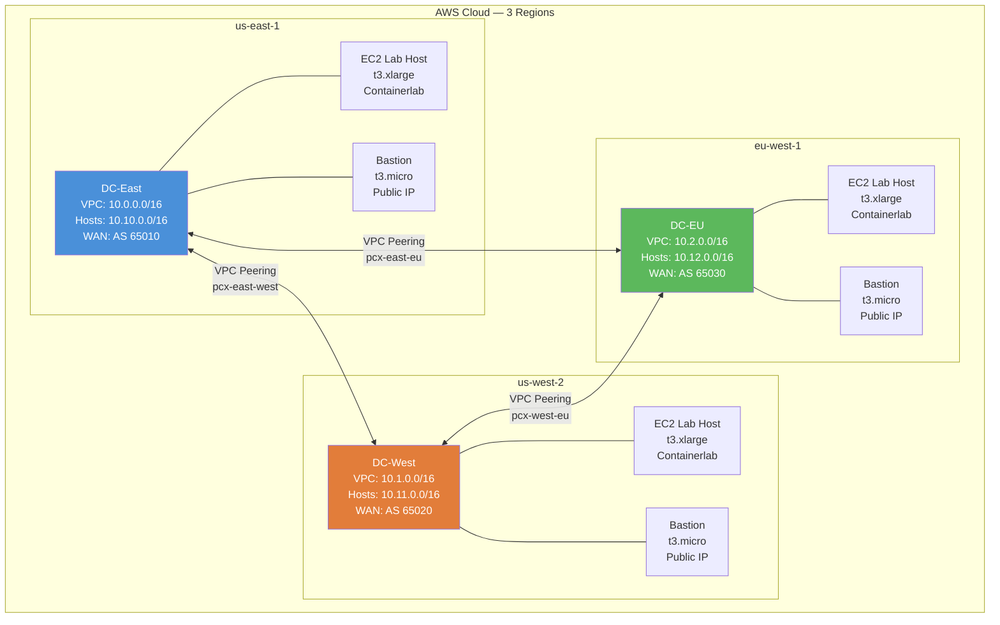
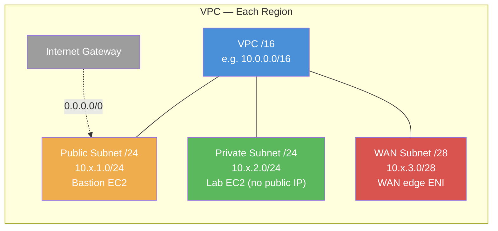
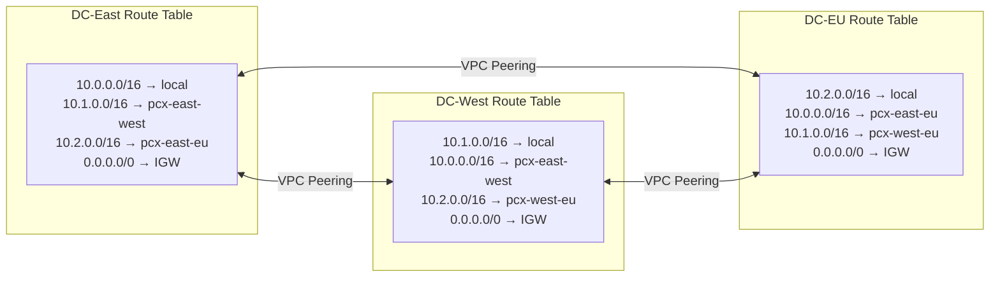

# Architecture Overview

## AWS Multi-Region Cloud Topology

This diagram shows the high-level three-region AWS architecture with VPC peering full-mesh connecting DC-East, DC-West, and DC-EU.

## VPC Subnet Layout Per Region

## Route Table — Full Mesh

Each VPC has routes to both other regions via peering connections:

