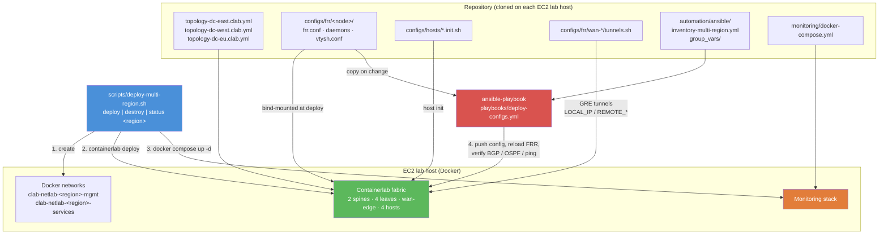
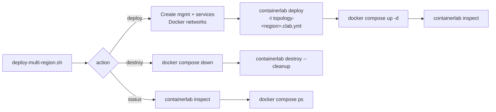
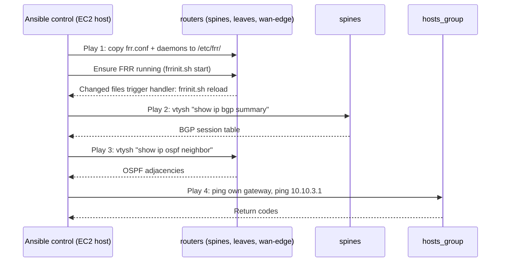
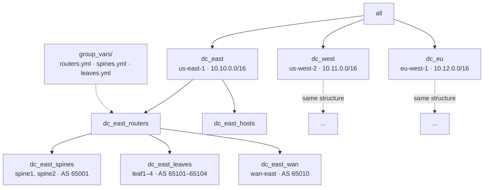

# Automation Workflow

How the deploy scripts, Containerlab topologies, FRR config files, and the Ansible playbook combine to build and configure one region. The same workflow runs independently on each region's EC2 lab host.

## Build Pipeline

## Deploy Script Actions

`scripts/deploy-multi-region.sh <action> <region>` (region defaults to `dc-east`):

| Region | Topology file | Mgmt network | Services subnet |
|--------|---------------|--------------|-----------------|
| dc-east | `topology-dc-east.clab.yml` | `clab-netlab-east-mgmt` | 10.20.0.0/24 |
| dc-west | `topology-dc-west.clab.yml` | `clab-netlab-west-mgmt` | 10.21.0.0/24 |
| dc-eu | `topology-dc-eu.clab.yml` | `clab-netlab-eu-mgmt` | 10.22.0.0/24 |

`scripts/deploy.sh` does the same for the original single-region `topology.clab.yml`.

## Ansible Playbook Plays

`automation/ansible/playbooks/deploy-configs.yml` runs four plays in order. Ansible connects as `root` over SSH to each node's management IP from the inventory.

## Inventory Structure

## Notes

- The playbook resolves config paths as `$PWD/../configs/frr/<node>/`, so run it from the `automation/` directory.
- Play 4's cross-fabric ping target (`10.10.3.1`) is a DC-East address; it verifies intra-region connectivity only.
- GRE tunnel endpoints (`LOCAL_IP`, `REMOTE_WEST`, `REMOTE_EU`, etc.) must be exported before deploying the WAN edge, because they are EC2 private IPs known only after Phase 1.
