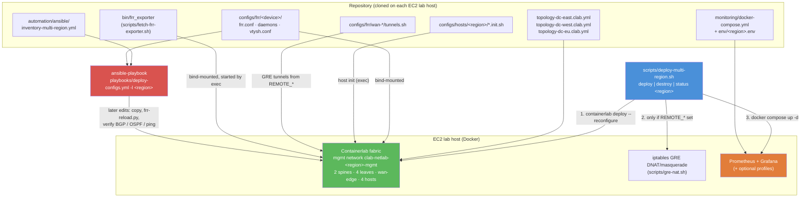
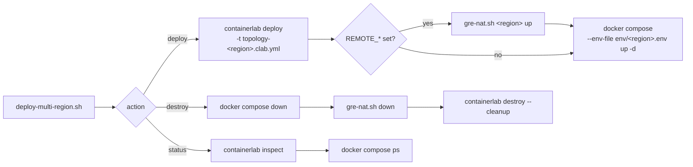
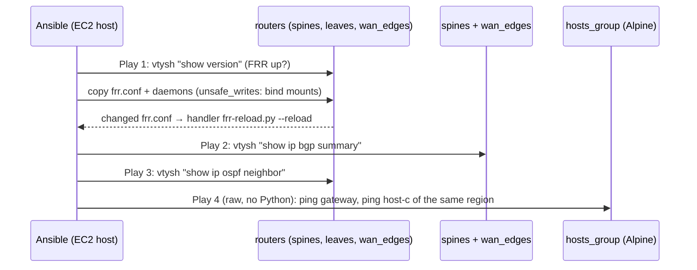
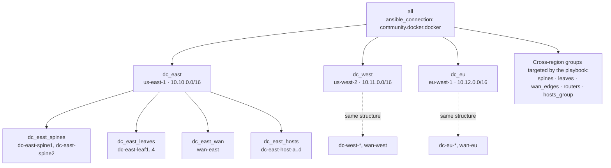

# Automation Workflow

How the deploy scripts, Containerlab topologies, FRR config files, and the Ansible playbook combine to build and configure one region. The same workflow runs independently on each region's EC2 lab host.

## Build Pipeline

## Deploy Script Actions

`scripts/deploy-multi-region.sh <action> <region>` (region defaults to `dc-east`):

| Region | Topology file | Mgmt network | Monitoring env |
|--------|---------------|--------------|----------------|
| dc-east | `topology-dc-east.clab.yml` | `clab-netlab-east-mgmt` 10.255.255.0/24 | `env/dc-east.env` |
| dc-west | `topology-dc-west.clab.yml` | `clab-netlab-west-mgmt` 10.254.255.0/24 | `env/dc-west.env` |
| dc-eu | `topology-dc-eu.clab.yml` | `clab-netlab-eu-mgmt` 10.253.255.0/24 | `env/dc-eu.env` |

`scripts/deploy.sh` does the same for the single-region `topology.clab.yml` (DC-East without the WAN edge). It shares the DC-East names and networks, so run one or the other.

## Ansible Playbook Plays

`automation/ansible/playbooks/deploy-configs.yml` runs four plays. Ansible connects with `docker exec` (`community.docker.docker`), since the FRR and Alpine images have no SSH server. Inventory names equal container names.

## Inventory Structure

## Notes

- Always limit a run to the local region (`-l dc_east`). The other regions' containers live on other EC2 hosts.
- The playbook finds configs relative to itself (`playbook_dir`), so it works from any directory.
- Changing a `daemons` file needs a node restart (`containerlab deploy ... --reconfigure`); the playbook warns when that happens.
