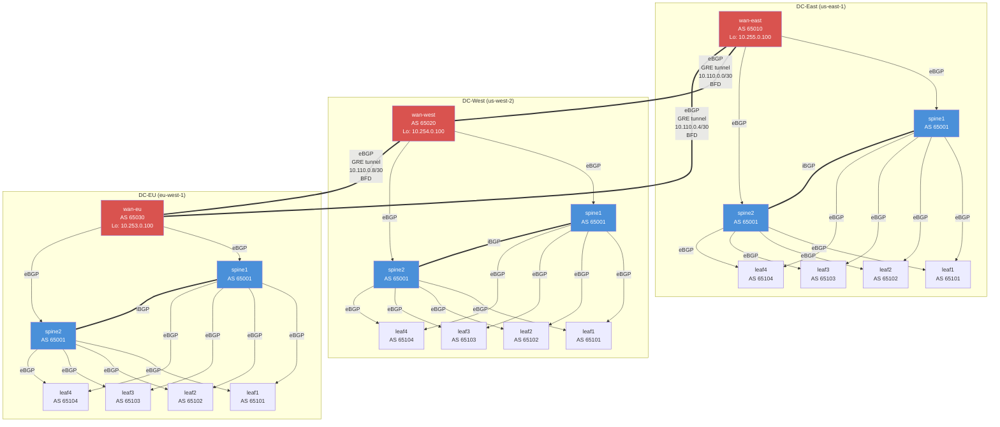
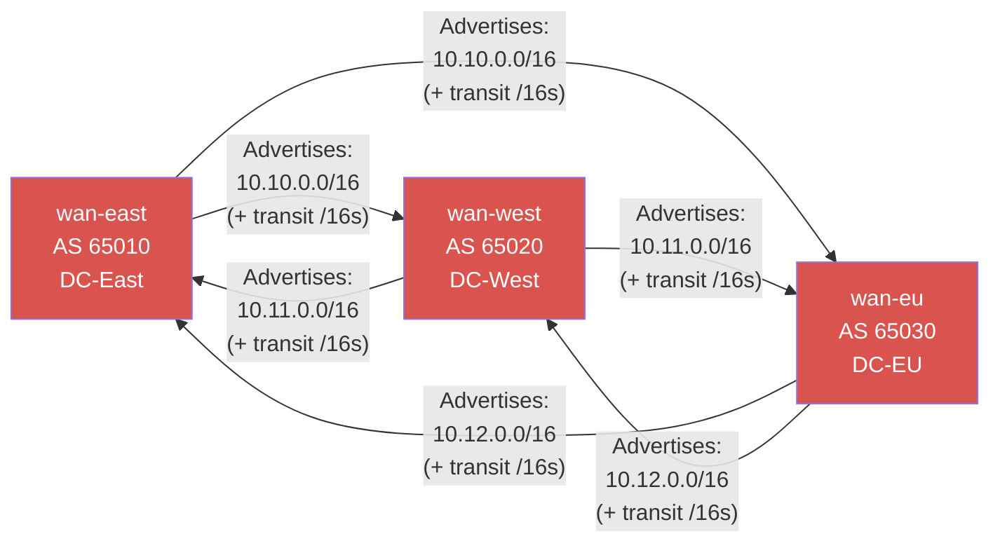
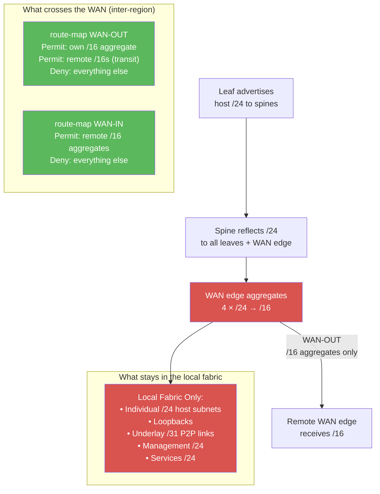
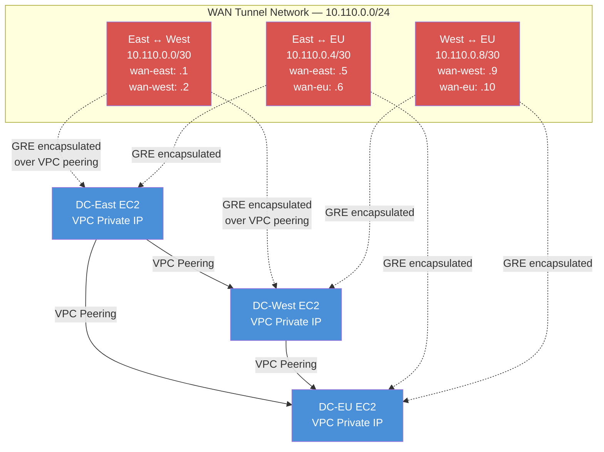

# BGP Peering Topology

## ASN Allocation

Internal fabric ASNs (65001, 65101-65104) are reused across all three regions because each Containerlab fabric is Docker-isolated and never peers externally. Only the WAN edge ASNs (65010, 65020, 65030) are unique and visible across regions.

## WAN Edge Peering (Inter-Region eBGP Full Mesh)

## BGP Route Propagation Flow

## GRE Tunnel Mesh

