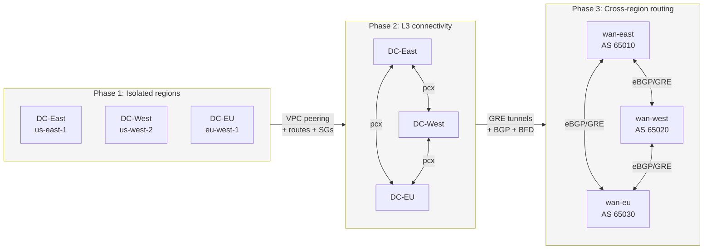
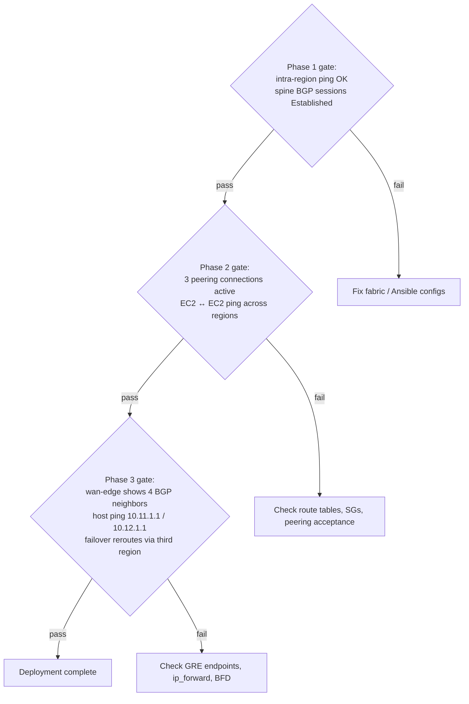

# Deployment Phases

Visual companion to [docs/deployment-phases.md](../deployment-phases.md), which has the full AWS CLI commands.

## Timeline

```mermaid
gantt
    title ResilientCloud phased rollout (~65 min)
    dateFormat HH:mm
    axisFormat %H:%M

    section Phase 1 - Independent regions
    DC-East VPC + EC2               :p1a, 00:00, 10m
    DC-West VPC + EC2               :p1b, 00:00, 10m
    DC-EU VPC + EC2                 :p1c, 00:00, 10m
    Install Docker + Containerlab   :p1d, after p1a, 15m
    Deploy fabric + monitoring      :p1e, after p1d, 5m

    section Phase 2 - VPC peering
    Create 3 peering connections    :p2a, after p1e, 5m
    Update 6 route tables           :p2b, after p2a, 5m
    Update security groups          :p2c, after p2b, 5m

    section Phase 3 - WAN edge BGP
    Enable IP forwarding            :p3a, after p2c, 2m
    GRE tunnels + WAN edge configs  :p3b, after p3a, 10m
    Verify BGP + failover test      :p3c, after p3b, 8m
```

## Phase Progression

## Verification Gates

Each phase must pass its checks before the next starts.

