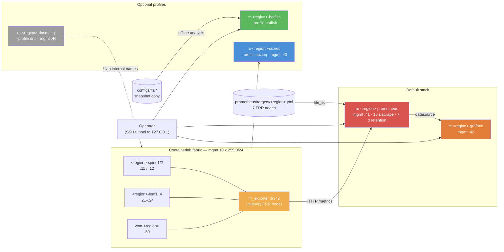
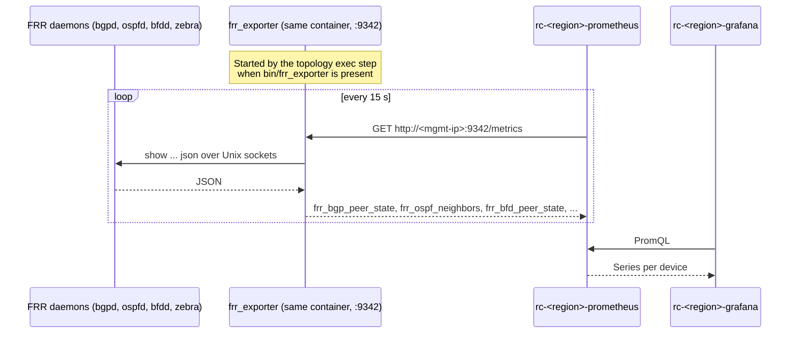
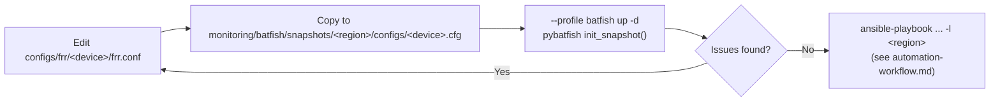

# Monitoring and Observability

Each region's EC2 lab host runs its own monitoring stack from `monitoring/docker-compose.yml`, configured by `monitoring/env/<region>.env`. Only Prometheus and Grafana start by default. SuzieQ, Batfish, and dnsmasq are opt-in compose profiles, so they use no resources unless enabled.

Every monitoring container joins two Docker networks: the region's services network (created by compose) and the region's Containerlab management network (created by `containerlab deploy`).

| Region | Mgmt network | Services network | Prometheus | Grafana |
|--------|--------------|------------------|------------|---------|
| dc-east | `clab-netlab-east-mgmt` 10.255.255.0/24 | `rc-dc-east-services` 10.20.0.0/24 | 127.0.0.1:9090 | 127.0.0.1:3000 |
| dc-west | `clab-netlab-west-mgmt` 10.254.255.0/24 | `rc-dc-west-services` 10.21.0.0/24 | 127.0.0.1:9091 | 127.0.0.1:3001 |
| dc-eu | `clab-netlab-eu-mgmt` 10.253.255.0/24 | `rc-dc-eu-services` 10.22.0.0/24 | 127.0.0.1:9092 | 127.0.0.1:3002 |

## Components and Data Flow

## What Each Tool Collects

| Tool | Default | Source | Method | Data |
|------|---------|--------|--------|------|
| frr_exporter | if `bin/frr_exporter` exists | FRR daemon sockets | Runs inside each FRR node | BGP peer state/prefixes, OSPF neighbors, BFD peer state, route counts |
| Prometheus | on | frr_exporter, Grafana, itself | HTTP scrape every 15 s | Time series, labelled `device`, `role`, `region` |
| Grafana | on | Prometheus | Datasource queries | Dashboards (FRR BGP dashboard: grafana.com ID 22943) |
| SuzieQ | `--profile suzieq` | FRR nodes | SSH every poll | interfaces, BGP, OSPF, routes, LLDP |
| Batfish | `--profile batfish` | Snapshot of `frr.conf` files | Offline parsing via pybatfish | Init issues, BGP session compatibility, reachability |
| dnsmasq | `--profile dns` | `dnsmasq/hosts.<region>` | Static hosts | `dc-east-spine1.lab.internal`, ... |

## Metrics Pipeline

## Batfish Validation Workflow

## Known Limits

- **Metrics need the binary.** If `scripts/fetch-frr-exporter.sh` was not run before `containerlab deploy`, the routers run normally and the Prometheus `frr` targets show as down.
- **SuzieQ needs SSH.** The FRR image has no SSH server. The steps to add one are in `monitoring/README.md`.
- **Default credentials.** Grafana is `admin`/`admin` unless `GRAFANA_ADMIN_PASSWORD` is exported first. All ports bind to 127.0.0.1 only.
