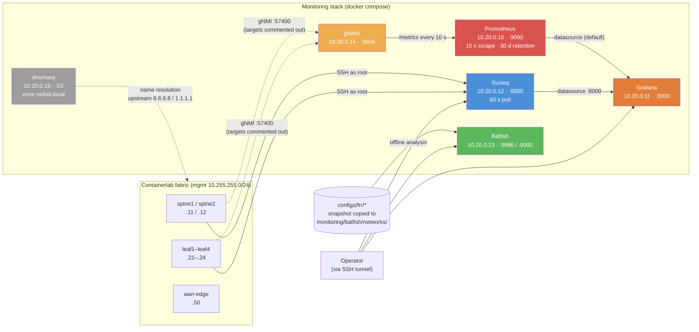
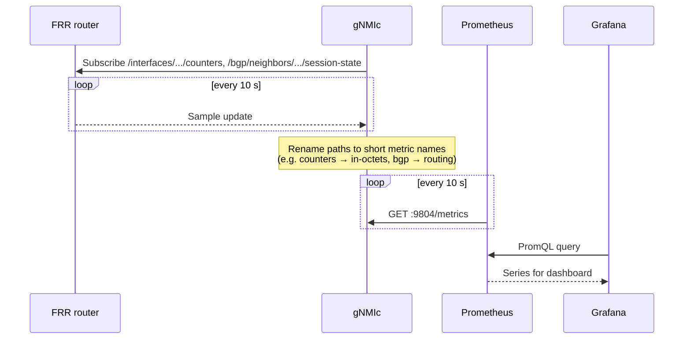
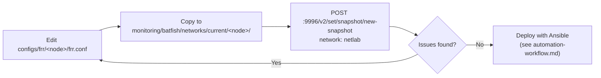

# Monitoring and Observability

The monitoring stack runs on each region's EC2 lab host, started from `monitoring/docker-compose.yml`. Every container joins two Docker networks: the services network (`10.20.0.0/24` in DC-East; `10.21.0.0/24` and `10.22.0.0/24` in the other regions per `scripts/deploy-multi-region.sh`) and the management network (`10.255.255.0/24`), which reaches the FRR routers.

## Components and Data Flow

## What Each Tool Collects

| Tool | Source | Method | Data | Interval |
|------|--------|--------|------|----------|
| gNMIc | spines, leaves | gNMI subscribe (`json_ietf`) | Interface counters, BGP neighbor session state | 10 s |
| Prometheus | gNMIc, Grafana, itself | HTTP scrape | Time-series metrics | 15 s (gNMIc: 10 s) |
| Suzieq | spines, leaves | SSH, `devtype: linux` | interfaces, bgp, ospf, routes, address, lldp, arpnd, vlan, mlag | 60 s |
| Batfish | Copied `frr.conf` snapshots | Offline config parsing | Routing loops, ACL conflicts, reachability | On demand |
| Grafana | Prometheus, Suzieq | Datasource queries | Dashboards | On view |
| dnsmasq | `monitoring/dnsmasq/hosts` | Static hosts file | `*.netlab.local` names | — |

## Telemetry Pipeline

## Batfish Validation Workflow

## Current Gaps

These are documented here so the diagrams match the config files as they stand.

- **No router telemetry yet.** All gNMIc targets in `monitoring/gnmic/gnmic.yml` are commented out because the FRR gNMI server is not enabled. Until it is, Prometheus only scrapes gNMIc, Grafana, and itself.
- **WAN edge not polled.** Suzieq's device list covers spines and leaves but not the wan-edge router.
- **Per-region config.** The Suzieq and gNMIc files list DC-East management IPs. The other regions reuse the same management range inside their own Docker networks, so the same files apply on each host.
- **Default credentials.** Grafana and gNMIc use `admin`/`admin`.
