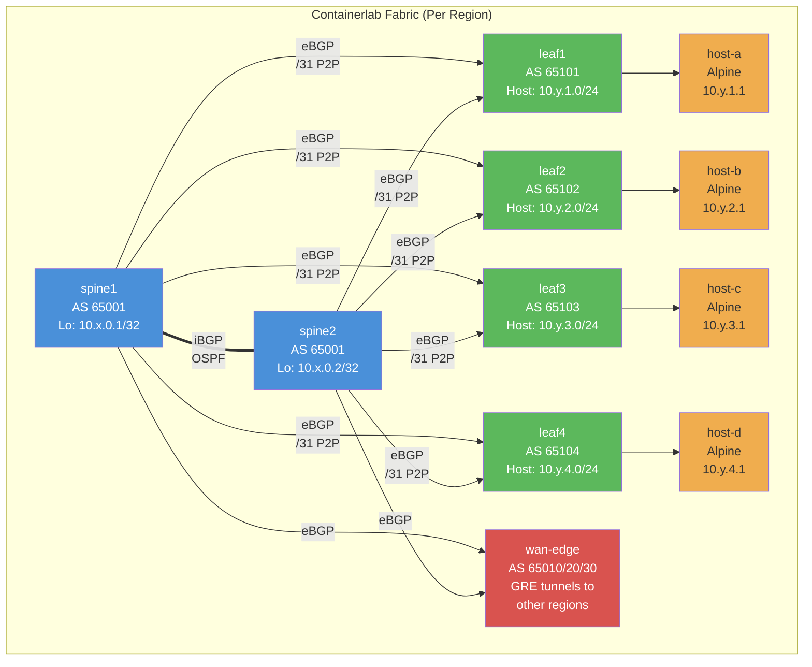
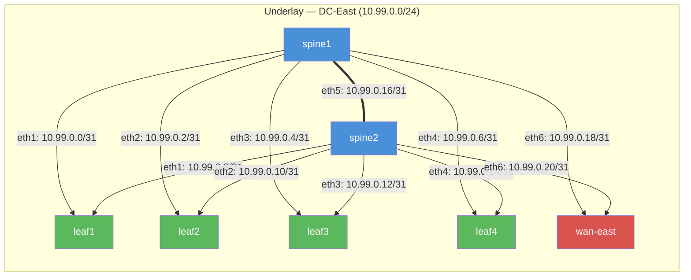
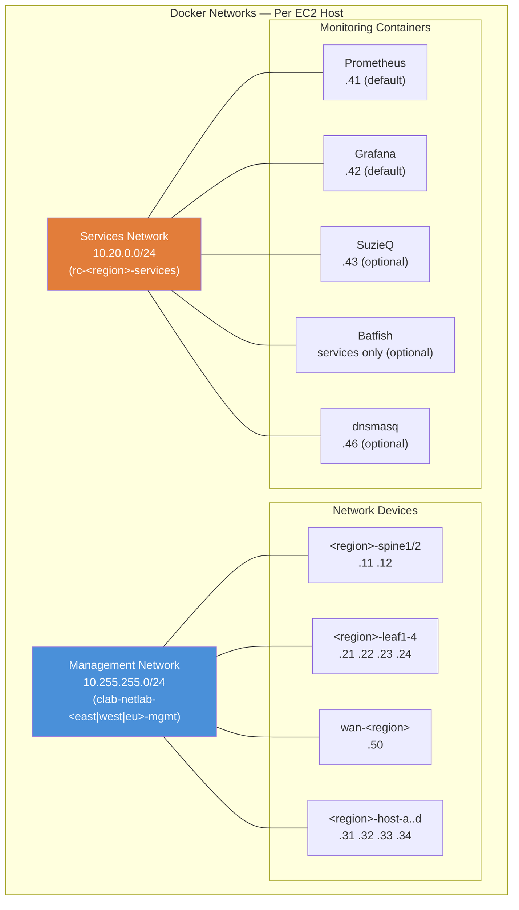

# Network Topology

## Per-Region Spine-Leaf Fabric

Each region runs an identical Containerlab topology: 2 spines, 4 leaves, 4 endpoint hosts, and 1 WAN edge router. The spines peer iBGP with each other and eBGP with every leaf and the WAN edge, with OSPF area 0 as the underlay. Device names carry the region prefix (dc-east-spine1, dc-west-leaf3, ...). Leaves peer eBGP with both spines and advertise their host /24 subnets.



## Underlay /31 Point-to-Point Links

Each spine-leaf pair uses /31 point-to-point links in OSPF area 0. The WAN edge also has uplinks to both spines.



## Management & Services Networks (Docker-Internal)

These networks exist only inside each EC2 host's Docker namespace. They are not routable across regions.



## IP Address Allocation Map

```
AWS VPC LEVEL (routable across regions)
├── 10.0.0.0/16  ── DC-East VPC (us-east-1)
├── 10.1.0.0/16  ── DC-West VPC (us-west-2)
└── 10.2.0.0/16  ── DC-EU VPC (eu-west-1)

CONTAINERLAB INTERNAL (Docker-isolated, BGP-advertised)
├── 10.10.0.0/16 ── DC-East host subnets (advertised)
├── 10.11.0.0/16 ── DC-West host subnets (advertised)
├── 10.12.0.0/16 ── DC-EU host subnets (advertised)
├── 10.255.0.0/24 ── DC-East loopbacks (advertised)
├── 10.254.0.0/24 ── DC-West loopbacks (advertised)
└── 10.253.0.0/24 ── DC-EU loopbacks (advertised)

WAN INTERCONNECT (GRE tunnels over VPC peering)
└── 10.110.0.0/24 ── Inter-region tunnel /30s

DOCKER-INTERNAL (not advertised, unique per region)
├── 10.99.0.0/24    ── DC-East underlay P2P
├── 10.100.0.0/24  ── DC-West underlay P2P
├── 10.200.0.0/24  ── DC-EU underlay P2P
├── 10.255.255.0/24 ── DC-East mgmt
├── 10.254.255.0/24 ── DC-West mgmt
├── 10.253.255.0/24 ── DC-EU mgmt
├── 10.20.0.0/24   ── DC-East services
├── 10.21.0.0/24   ── DC-West services
└── 10.22.0.0/24   ── DC-EU services
```
