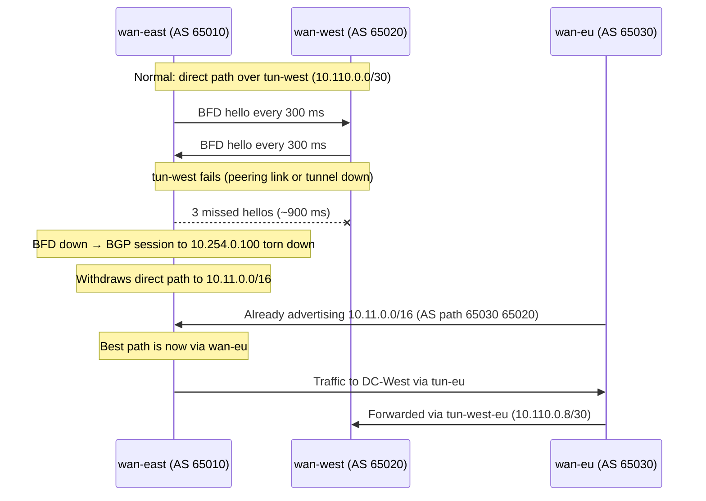
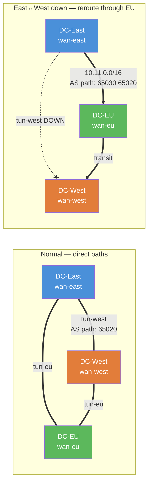
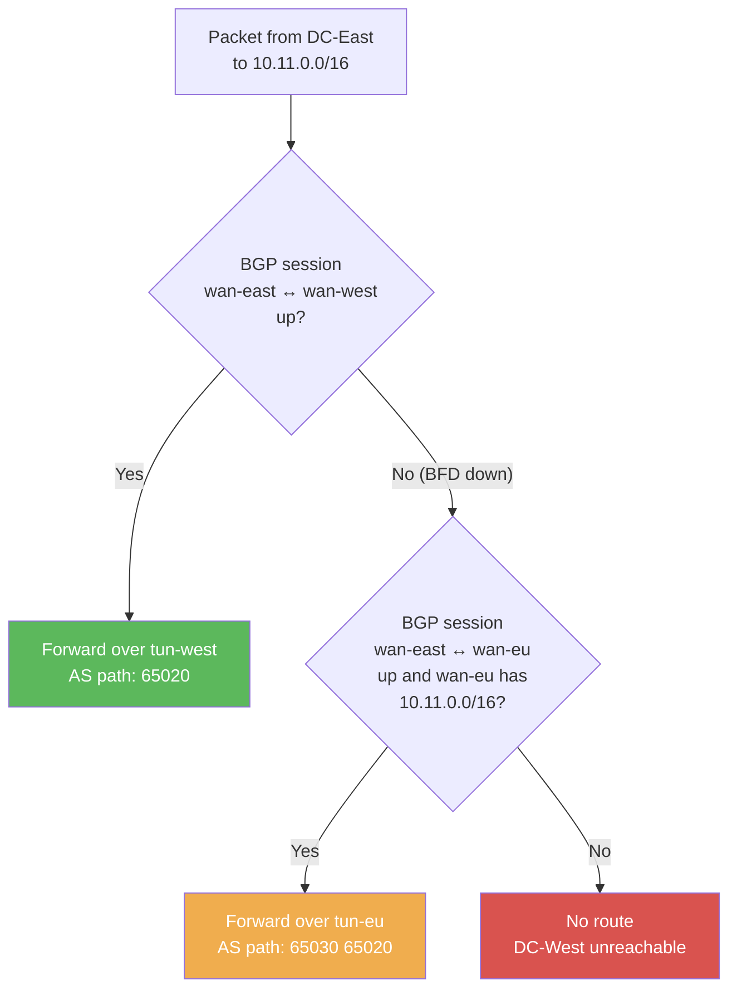

# Resilience and Failover

## Failure Detection

Each WAN edge runs BFD on its eBGP sessions to the two remote WAN edges. BFD uses a 300 ms transmit/receive interval with a detect multiplier of 3, so a dead tunnel is detected in about 900 ms. If BFD is unavailable, BGP keepalive/hold timers (3 s / 9 s) act as the fallback.

## Normal State vs. Single-Link Failure

## Failure Scenarios

| Failure | Detection | Effect | Recovery path |
|---------|-----------|--------|---------------|
| One GRE tunnel / VPC peering link | BFD ~900 ms | Direct path withdrawn | Transit via third region (longer AS path) |
| Two inter-region links | BFD ~900 ms | Isolated region loses WAN reachability | None until a link returns; local fabric unaffected |
| WAN edge router in one region | BFD on all its sessions | Region's /16 withdrawn from remote regions | Intra-region traffic continues; cross-region down for that region |
| One spine in a region | BFD / OSPF | ECMP drops to the remaining spine | Remaining spine reflects all routes |
| One leaf | Host link down | Hosts behind that leaf unreachable | None (single-homed hosts in the lab) |
| Entire region (EC2 host down) | BFD on both remote sessions | Region's /16 withdrawn | Other two regions keep a direct path |

## Failover Decision Flow

## Failover Test

See the "Test Failover" section of the [README](../../README.md). Shut down `tun-west` on wan-east, then confirm with `traceroute 10.11.1.1` that the path now passes through wan-eu.
