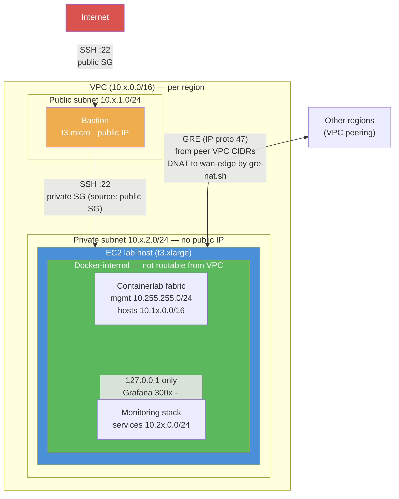
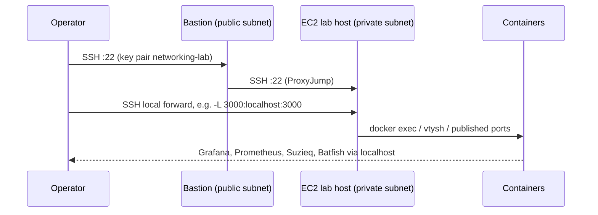
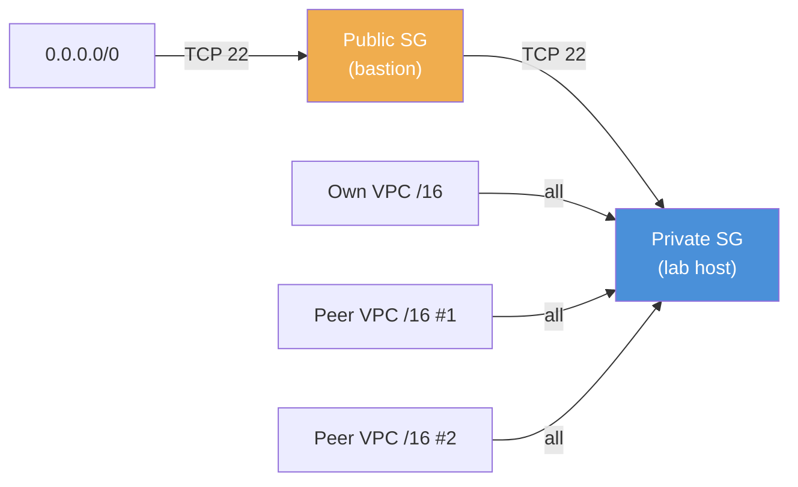

# Security and Access

Trust boundaries, the operator access path, and the security group rules defined in [docs/deployment-phases.md](../deployment-phases.md). The same pattern applies in all three regions.

## Trust Boundaries



## Operator Access Path

The lab host has no public IP. Reach it, and the dashboards on it, through the bastion.



Example (replace placeholders):

```bash
ssh -i ~/.ssh/networking-lab.pem \
  -J ec2-user@<bastion-public-ip> \
  -L 3000:localhost:3000 -L 9090:localhost:9090 \
  ec2-user@<lab-host-private-ip>
```

## Security Group Rules

| SG | Direction | Protocol / Port | Source | Purpose | Phase |
|----|-----------|-----------------|--------|---------|-------|
| Public (bastion) | Inbound | TCP 22 | 0.0.0.0/0 | Operator SSH | 1 |
| Private (lab host) | Inbound | TCP 22 | Public SG | SSH from bastion only | 1 |
| Private (lab host) | Inbound | All | Own VPC CIDR | Intra-VPC traffic | 1 |
| Private (lab host) | Inbound | All | Each peer VPC CIDR (2 rules) | GRE tunnels, BGP, cross-region data | 2 |
| Both | Outbound | All | 0.0.0.0/0 | AWS default | — |



## Secrets and Credentials

| Item | Where it lives | In repo? |
|------|----------------|----------|
| EC2 SSH key pair | `~/.ssh/networking-lab*.pem` on the operator machine | No (`*.pem` in `.gitignore`) |
| Grafana admin | `GRAFANA_ADMIN_PASSWORD` env var | No (falls back to lab default `admin`) |
| Ansible to routers | `docker exec` on the lab host | No credentials needed |
| SuzieQ SSH key (optional) | `monitoring/suzieq/ssh/` | No (git-ignored) |

## Hardening Notes (lab vs. production)

These choices fit a lab and should change for anything longer-lived:

- Restrict the bastion's SSH rule from `0.0.0.0/0` to your own IP, or replace the bastion with AWS Systems Manager Session Manager.
- Narrow the cross-region rule from "all traffic" to GRE (IP protocol 47) between the lab hosts' private IPs.
- Set `GRAFANA_ADMIN_PASSWORD` (or pull it from AWS Secrets Manager) instead of the `admin` default.
- GRE is unencrypted. Traffic stays on the AWS backbone over VPC peering, but add IPsec if confidentiality between regions matters.
