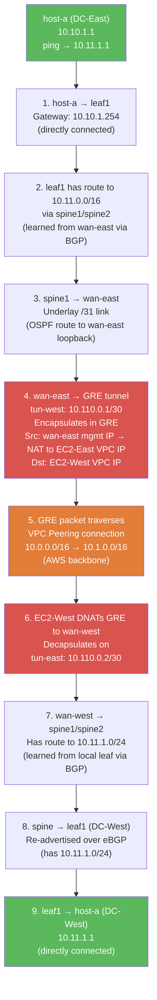
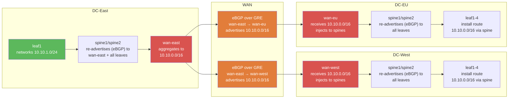
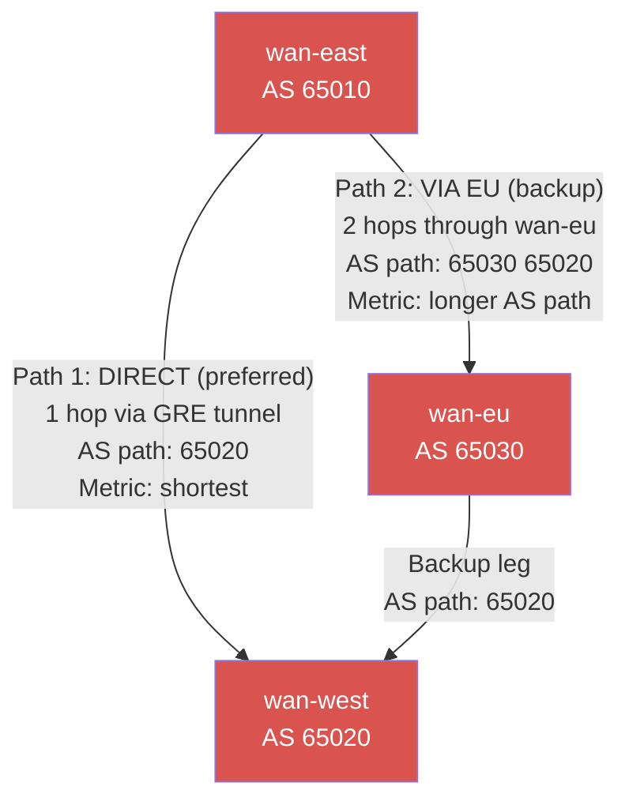
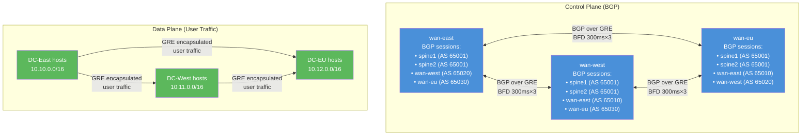

# Traffic Flow

## Cross-Region Traffic Path

This diagram traces the path of a packet from a host in DC-East to a host in DC-West, showing how traffic flows through the local fabric, WAN edge, GRE tunnel, VPC peering, and remote fabric.

## Route Learning — Step by Step

## BGP Path Selection — Direct vs Transitive

With the full mesh, each WAN edge has two paths to each remote region. BGP prefers the shorter AS path (direct), and the transitive path through the third region serves as backup.

## Data Plane vs Control Plane

